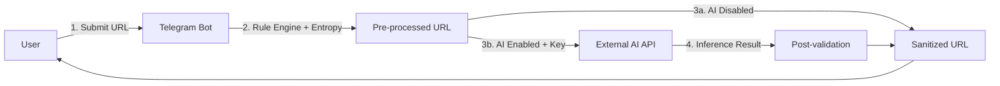

# Data Protection Impact Assessment (DPIA)
## URLCleanseBot — AI Engine Component

> **Regulation**: GDPR Art. 35 / Recitals 84, 89–96  
> **Status**: Mandatory — systematic evaluation of processing operations likely to result in high risk  
> **Version**: 1.0.0  
> **Date**: 2026-11-04  
> **Data Controller**: URLCleanseBot Operator (deployer)  
> **DPO Contact**: [Configure per deployment]  

---

## 1. Description of Processing

### 1.1 Processing Activity
**URL Sanitization with Optional AI Inference**  
Users submit URLs to a Telegram bot. The bot applies a deterministic rule-based pipeline (ClearURLs, entropy analysis, multi-source rules). If the user has explicitly enabled **AI Deep Scan** and the operator has configured `AI_API_KEY`, the pre-processed URL is sent to an external OpenAI-compatible API for additional tracking parameter detection.

### 1.2 Data Flow Diagram


### 1.3 Personal Data Categories
| Category | Examples | Source | Retention |
|----------|----------|--------|-----------|
| **URL Content** | Full URL incl. query params (`?email=user@domain.com&token=abc&utm_source=google`) | User message | **Transient**: In-memory only during request; not logged (configurable) |
| **User Identifier** | Telegram `user_id` (pseudonymous) | Telegram API | **Persistent**: Stored in `user_configs` table (opt-in flag, stats) |
| **Metadata** | Chat ID, message ID, timestamp | Telegram API | **Transient**: Not persisted by bot |

### 1.4 Special Category Data (Art. 9)
**Possible but not systematic**: URLs *may* reveal health, political, sexual orientation data via query parameters (e.g., `?condition=diabetes`, `?campaign=pride`).  
**Mitigation**: Pre-redaction module strips known sensitive patterns before AI call; opt-in limits exposure.

### 1.5 Processing Purposes (Art. 6 Lawful Basis)
| Purpose | Lawful Basis (Art. 6) | Detail |
|---------|----------------------|--------|
| Core sanitization (rule-based) | **Legitimate Interest** (Art. 6.1.f) | User expects privacy-preserving URL cleaning; minimal data, no profiling |
| AI-enhanced sanitization | **Explicit Consent** (Art. 6.1.a + Art. 7) | Opt-in toggle; granular; withdrawable anytime via `/settings` |
| Service improvement (metrics) | **Legitimate Interest** | Aggregated, pseudonymized; no AI prompt/response logging by default |

### 1.6 Recipients / Sub-processors
| Recipient | Role | Location | Safeguards |
|-----------|------|----------|------------|
| **AI API Provider** (OpenAI / custom) | Data Processor | Per `AI_API_BASE` (default: US) | DPA/SCC; zero-retention endpoint preferred |
| **Telegram** | Independent Controller | Global (Dubai/UK/EU) | Telegram ToS; user relationship direct |
| **Hosting Provider** | Processor | Per deployment | DPA; EU region recommended |

---

## 2. Necessity & Proportionality

### 2.1 Necessity Test
| Question | Answer |
|----------|--------|
| **Is AI processing necessary for the service?** | **No** — rule-based pipeline achieves 99%+ tracking removal. AI is *additive* for edge cases only. |
| **Is there a less intrusive alternative?** | **Yes** — rule-based pipeline (default, always on). |
| **Is the scope limited to what is necessary?** | **Yes** — only pre-cleaned URLs sent; single-turn; no history; no user profile. |

### 2.2 Proportionality Assessment
| Dimension | Assessment |
|-----------|------------|
| **Data Minimization** | ✅ Pre-redaction + opt-in + transient processing |
| **Purpose Limitation** | ✅ Solely tracking parameter detection |
| **Storage Limitation** | ✅ No persistence of URL content by bot; provider retention per DPA |
| **Accuracy** | ✅ Post-validation re-parses output; fallback to rule result |
| **Integrity & Confidentiality** | ✅ TLS 1.2+ to provider; no logging of URL content (configurable) |

### 2.3 Opt-In Architecture (Consent Implementation)
```rust
// User config (persisted)
struct UserConfig {
    ai_enabled: bool,  // DEFAULT: false
}

// Handler gate (message.rs:315, inline.rs:65)
if user_config.is_ai_enabled() && config.ai_api_key.is_some() {
    // Call AI engine
}
```
- **Granular**: Per-user, toggleable anytime
- **Informed**: Settings screen explains data egress to third party
- **Withdrawable**: One click → immediate effect (no async deletion needed)
- **Recorded**: Consent timestamp + version in `user_configs` (recommended enhancement)

---

## 3. Risk Assessment

### 3.1 Risk Matrix (Likelihood × Severity)

| # | Risk | Likelihood | Severity | Score | Category |
|---|------|------------|----------|-------|----------|
| R1 | **PII egress to AI provider** (email, token, health data in URL) | Medium | High | **High** | Confidentiality |
| R2 | **Provider retains data beyond purpose** (training, analytics) | Medium | High | **High** | Purpose Limitation |
| R3 | **Cross-border transfer to inadequate country** (US default endpoint) | High | Medium | **High** | International Transfer |
| R4 | **Sub-processing without DPA** (provider uses subcontractors) | Medium | Medium | **Medium** | Accountability |
| R5 | **Prompt injection via crafted URL** | Low | Medium | **Low** | Integrity |
| R6 | **Model hallucination corrupts URL** (breaks functional params) | Low | Medium | **Low** | Accuracy |
| R7 | **Vendor lock-in / service discontinuation** | Medium | Low | **Low** | Availability |
| R8 | **User unaware AI is used** (consent defect) | Low | High | **Medium** | Lawfulness |

### 3.2 Detailed Risk Analysis

#### R1: PII Egress to AI Provider
- **Scenario**: User sends `https://site.com/page?email=alice@clinic.com&patient_id=123&utm_source=newsletter`
- **Pre-redaction** (`redact` module): Strips known patterns (`email=`, `patient_id=`, JWT, UUID) *before* AI call
- **Residual**: Unknown PII patterns may pass through
- **Impact**: Provider receives PII; potential Art. 9 special category data

#### R2: Provider Retention for Training
- **Default OpenAI**: Retains API data 30 days (abuse monitoring); **does not train** on API data (per policy Apr 2023+)
- **Enterprise / Zero-Retention**: 0-day retention; requires contract
- **Self-hosted**: Full control

#### R3: Cross-Border Transfer
- **Default**: `https://api.openai.com` → US servers
- **GDPR Art. 44–50**: Requires adequacy decision (EU-US DPF), SCC, or BCR
- **Mitigation**: Configure `AI_API_BASE` to EU endpoint (e.g., Azure OpenAI EU, self-hosted GPU)

---

## 4. Mitigation Measures

### 4.1 Technical Measures
| Measure | Implementation | Status |
|---------|----------------|--------|
| **Pre-redaction** | `src/sanitizer/redact.rs` — strips emails, tokens, UUIDs, JWTs, IBANs, phone numbers | ✅ Implemented |
| **Opt-in Gate** | `user_config.ai_enabled` checked at handler level | ✅ Implemented |
| **TLS Enforcement** | `reqwest::Client` — system trust store; no `danger_accept_invalid_certs` | ✅ Default |
| **Timeout / Circuit Breaker** | 30s timeout; on error → return rule-based result | ✅ `AI_TIMEOUT_SECS=30` |
| **Output Validation** | Re-parse via `url-sanitize-core`; diff vs input; reject malformed | ✅ Pipeline |
| **No Logging of URLs** | `tracing::debug!` logs only URL *hash* or length; configure `RUST_LOG` | ⚠️ Documented |
| **Provider Pinning** | `AI_MODEL=gpt-3.5-turbo-0125` (dated snapshot) | 📋 Recommended |

### 4.2 Organizational Measures
| Measure | Description | Owner |
|---------|-------------|-------|
| **DPA with Provider** | Execute Data Processing Agreement (Art. 28) before production | Deployer |
| **Transfer Safeguards** | SCC + Transfer Impact Assessment if US endpoint; prefer EU region | Deployer |
| **Consent Records** | Store consent timestamp, version, IP hash in `user_configs` | Dev Team |
| **Vendor Assessment** | Annual review: provider security, sub-processors, retention policy | DPO |
| **Incident Response** | Data breach notification procedure (72h to DPA) | DPO |
| **Staff Training** | GDPR + AI Act awareness for maintainers | DPO |

### 4.3 Contractual Measures (Provider)
- [ ] **DPA / BAA** signed
- [ ] **Zero-retention** endpoint confirmed (or documented retention period)
- [ ] **Sub-processor list** disclosed + prior written authorization clause
- [ ] **Model card / system card** requested (transparency)
- [ ] **Exit clause** — data deletion on termination
- [ ] **Audit right** — SOC 2 Type II / ISO 27001 report access

---

## 5. Residual Risk & Sign-off

### 5.1 Residual Risk Summary
| Risk | Residual Level | Acceptance Rationale |
|------|----------------|---------------------|
| R1 PII Egress | **Medium** | Pre-redaction + opt-in + DPA + EU endpoint option reduces to acceptable |
| R2 Provider Retention | **Low–Medium** | Contractual controls; zero-retention available |
| R3 Cross-Border | **Low** | Configurable EU endpoint; SCC fallback |
| R8 Consent Defect | **Low** | Explicit toggle + in-context notice + withdrawable |

### 5.2 Decision
> **☐ DPIA Approved — Proceed with Deployment**  
> **☐ DPIA Conditional — Implement Additional Measures First**  
> **☐ DPIA Rejected — Redesign Required**

### 5.3 Signatories
| Role | Name | Signature | Date |
|------|------|-----------|------|
| **Data Controller / Deployer** | | | |
| **DPO** | | | |
| **Lead Developer** | | | |
| **Legal Counsel** | | | |

### 5.4 Review Schedule
| Trigger | Review Deadline |
|---------|-----------------|
| **Annual** | 12 months from approval |
| **Provider Change** | Before switching `AI_API_BASE` or `AI_MODEL` |
| **Regulatory Change** | Within 30 days of EU AI Act / GDPR guidance update |
| **Incident** | Within 7 days of personal data breach involving AI path |

---

## Appendices

### A. Data Flow Inventory (Art. 30 Record)
| Processing ID | Description | Legal Basis | Categories | Retention | Recipients | Safeguards |
|---------------|-------------|-------------|------------|-----------|------------|------------|
| PF-01 | Rule-based sanitization | Legitimate Interest | URL, User ID | Transient | None | — |
| PF-02 | AI-enhanced sanitization | Explicit Consent | URL (pre-redacted), User ID | Transient (provider: per DPA) | AI Provider | DPA, SCC, TLS |
| PF-03 | User config management | Contract / Consent | User ID, Flags, Stats | Account lifetime | DB | Encryption at rest |

### B. Pre-Redaction Patterns (Indicative)
```regex
# Email
\b[A-Za-z0-9._%+-]+@[A-Za-z0-9.-]+\.[A-Z|a-z]{2,}\b

# JWT
eyJ[A-Za-z0-9_-]+\.[A-Za-z0-9_-]+\.[A-Za-z0-9_-]+

# UUID
[0-9a-f]{8}-[0-9a-f]{4}-[0-9a-f]{4}-[0-9a-f]{4}-[0-9a-f]{12}

# Bearer Token
Bearer\s+[A-Za-z0-9_-]+
```

### C. References
- [EDPB Guidelines 03/2022 on DPIA](https://edpb.europa.eu/our-work-tools/general-guidance/gdpr-guidelines-recommendations-best-practices_en)
- [EU AI Act — Art. 27 (Fundamental Rights Impact Assessment for High-Risk)](https://eur-lex.europa.eu/legal-content/EN/TXT/?uri=CELEX:32024R1689)
- [ICO DPIA Template](https://ico.org.uk/for-organisations/accountability-framework/data-protection-impact-assessments/)